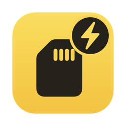
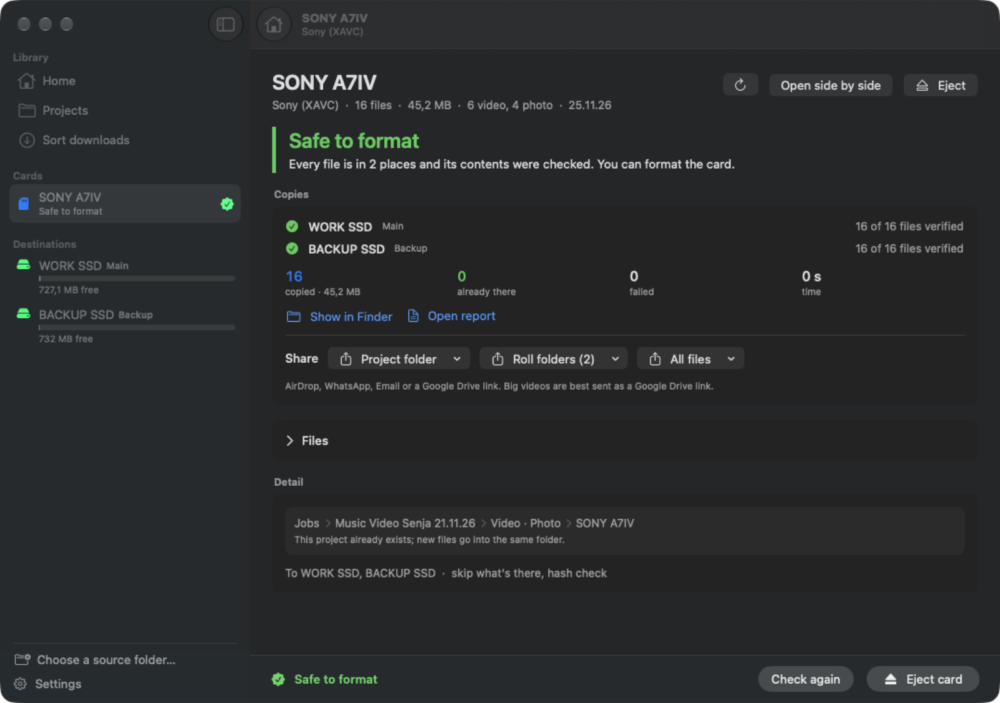
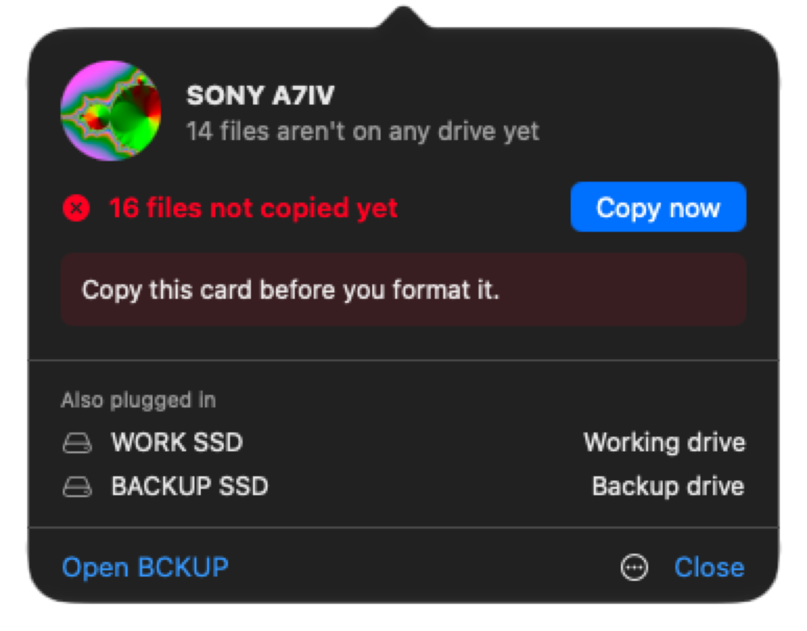
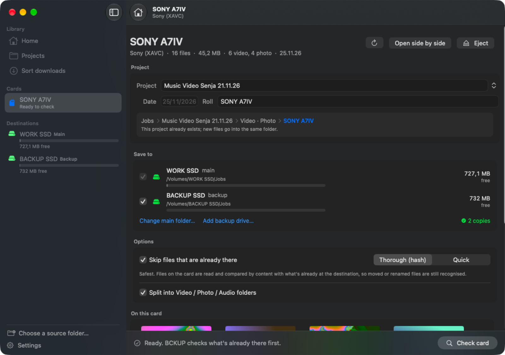
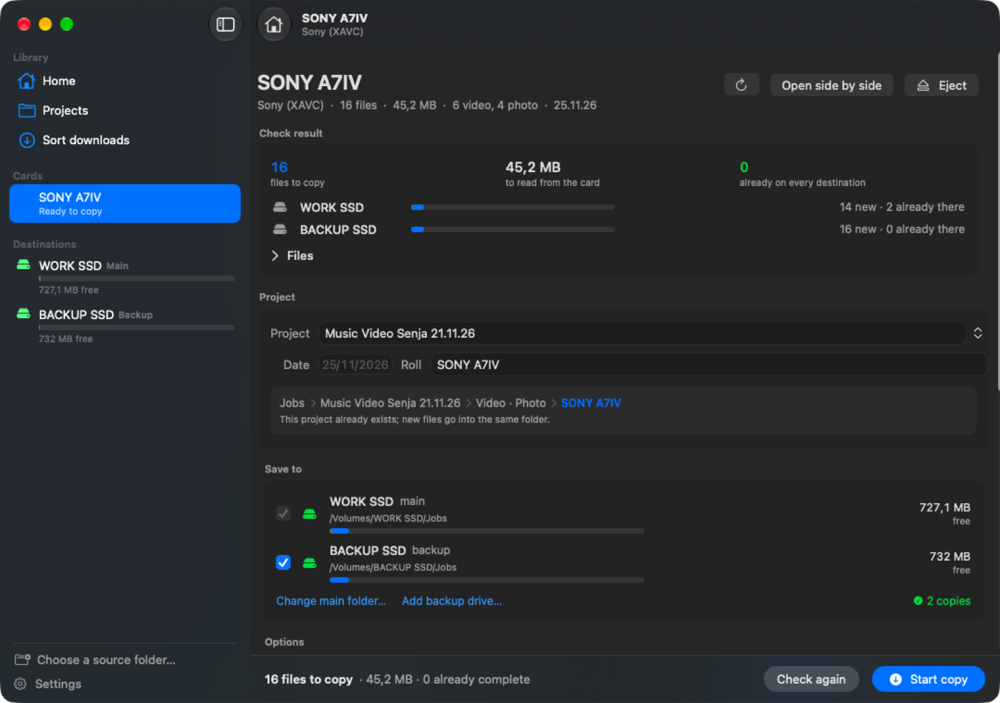
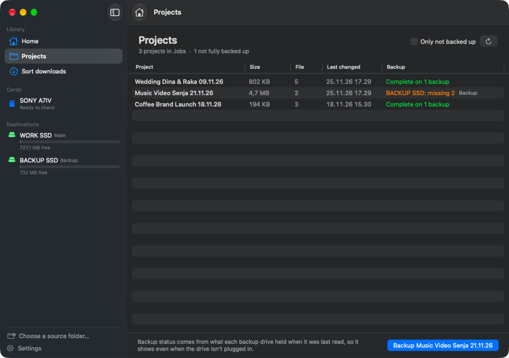
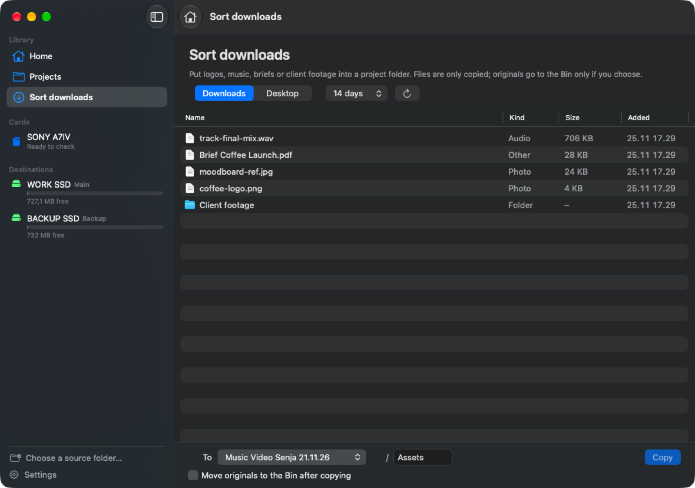

# BCKUP

Verified camera card offloads for macOS and Windows.

Plug in a card and BCKUP checks whether its contents are already on your drives. It copies to the main folder and every backup drive at once, reads each copy back from disk and checks it with xxHash64, skips files that are already there, and tells you when a card is **Safe to format**.



| | macOS | Windows |
|---|---|---|
| Folder | [`mac/`](mac) | [`windows/`](windows) |
| Built with | Swift / SwiftUI | Tauri 2 (Rust + HTML/JS) |
| Build | `cd mac && ./build.sh` | see [`windows/README.md`](windows/README.md) |
| Download | [`BCKUP-mac-1.0.zip`](https://github.com/vgz13/bckup/releases/latest/download/BCKUP-mac-1.0.zip) | [`BCKUP-Setup.exe`](https://github.com/vgz13/bckup/releases/latest/download/BCKUP-Setup.exe) |

Both apps share the same rules and folder layout, so a drive filled by one is understood by the other:

```
Main folder / Project + date / Video · Photo · Audio / Roll / original card structure
                             / MATERIAL / Video / iPhone 15 Pro / IMG_4821.MOV
                                        / Graphics / logo.png
                                        / Documents / brief.pdf
                             / _BCKUP Reports / <roll> <date>.txt + .csv
```

## Screenshots

Shown with demo cards and drives on macOS. The Windows app has the same screens, with a tray icon instead of the menu bar.

**When a card goes in**, a panel opens from the menu bar and says whether the card is already copied.



**Set up the copy.** Pick the project and roll, see exactly which folders will be made, and choose the drives.



**Check first.** BCKUP compares the card with every destination before copying anything, and shows what's new and what's already there.



**Projects** shows every project on the working drive and whether each backup drive has all of it, even when that drive isn't plugged in.



**Sort downloads** copies logos, music, briefs and client footage into a project's Assets folder.



## Features

- Card detection (Sony, Canon, Nikon, Fujifilm, Panasonic, Blackmagic, RED, ARRI, DJI, GoPro, Insta360, audio recorders and more) with a menu bar / tray panel
- Copy to several drives at once, verified with xxHash64; nothing half-copied ever has its real name
- Skip what's already there by content hash (or a quick name/size/date check); existing files are never overwritten
- Projects view with backup status per drive and one-click backup
- Assets go to `Project / MATERIAL /` sorted by type (Video, Photo, Audio, Graphics, Documents, Fonts, Project Files, Archives, Other), with a folder per camera or phone for video and photos (iPhone, Android, Sony, Canon, DJI, GoPro… read from the files' own metadata)
- Sort downloads into a project's MATERIAL folder
- Every folder name can be renamed (Rename folders… on the card screen, or Settings → Folder layout)
- Card thumbnails, drag and drop, filterable file lists
- Sharing: WhatsApp, Email, Google Drive link (plus AirDrop on macOS)
- Google Drive upload with MD5 check through rclone, signed in with each person's own Google account

## Downloads

Installers are attached to the GitHub Releases. Neither is code-signed yet:

- macOS: right-click `BCKUP.app` → Open the first time.
- Windows: double-click `BCKUP-Setup.exe`. There are no questions to answer: it installs for your user account (no admin rights), adds Start menu and desktop shortcuts, and opens BCKUP. If SmartScreen says "Windows protected your PC", click More info → Run anyway. Uninstall from Settings → Apps.
